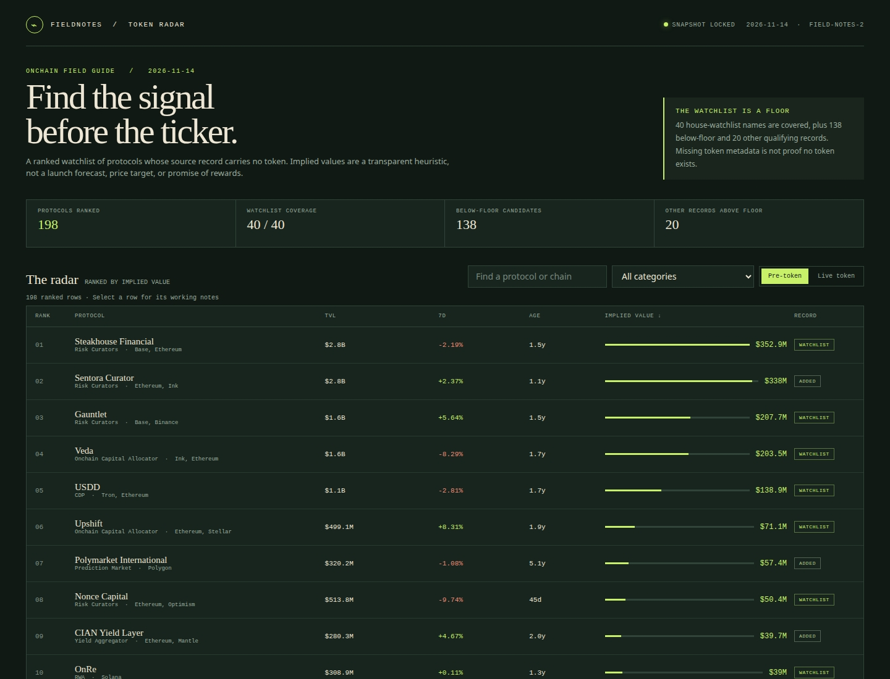

# Fieldnotes — Token Launch Radar

[](https://make.fun/bounty/token-radar-01)
[](https://make.fun/bounty/token-radar-01)
[](https://make.fun/bounty/token-radar-01)

An offline research dashboard for the [make.fun token-launch radar challenge](https://make.fun/bounty/token-radar-01). It ranks pre-token protocols from a supplied snapshot, explains a simple valuation heuristic and shows a concrete, cautious research plan for each candidate. The challenge snapshot used during development produced 198 ranked entries and covered all 40 required watchlist projects. Results depend on the input snapshot.



## Run

Requires Node.js 22.18 or later and a browser. No package installation or network access is needed to process an existing snapshot.

```sh
node main.ts --input /path/to/snapshot.json --output /path/to/output
```

`--input` accepts a snapshot JSON file or a directory containing `snapshot.json`; it defaults to `/input`. `--output` defaults to `/output`. Open `dashboard/index.html` inside the output directory in a browser. The program also writes `board.json`, `data.js`, `dossier.json`, and the included screenshots to the output directory.

The `npm run build` convenience script points to the adjacent local challenge-kit location used during development; edit that path for your environment or use the direct command above. The input snapshot is not bundled in this repository.

## How it works

The dashboard filters and ranks candidates, separates live-token references, and lets readers search, filter and inspect individual protocols. Estimated value is a transparent heuristic based on TVL, capped seven-day growth and protocol age; it is not a market price or a forecast. The suggested actions and cost estimates are illustrative, not guarantees of eligibility or rewards.

Crypto protocols can lose value or be compromised, and interacting with them can incur fees. This project is for research only and is not investment advice. Verify current information and risks independently before taking action.

## License

MIT; see [LICENSE](LICENSE).
